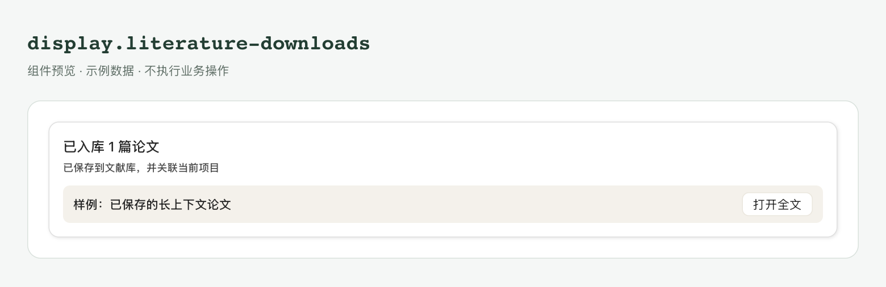
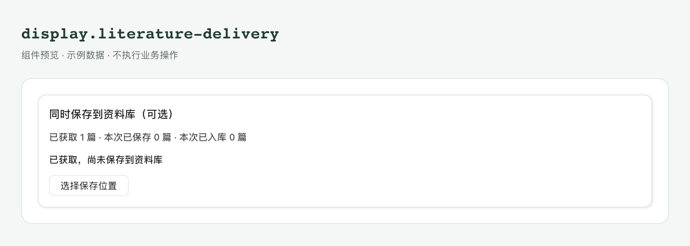

# Plugin 公共对话卡片

**简体中文** · [English](cards.md) · [离线阅读](../plugins.zh.html#cards)

[Plugin 概览](../plugins.zh.md)

先选择卡片由谁驱动，再选择界面。**公共 slot 是业务入口；Conversation 是可组合的 UI，两者不是一回事。**

## 选择卡片

| 你要做什么 | 使用什么 |
| --- | --- |
| 复用检索、文献选择、授权或保存流程 | 由所属领域工具驱动公共 slot |
| 自己组织已有对话 UI | Conversation 组件，并接入实际 props 和回调 |
| 在回答中组合图表、数据表、证据或产物预览 | 先使用 `scholarseed-product-operations` 的对话卡片指南及现有组合 slot |
| 收集自己的业务选择 | 自定义 slot、数据/动作 schema 和组件代码 |

## 公共业务 slot

| slot | 显示内容 | 使用方式 | 书深前端实现 |
| --- | --- | --- | --- |
| `interaction.question` | 问题选项与确认 | 由 AI 的原生提问流程展示并收集回答。 | [Choices.tsx:19](../../apps/desktop/src/renderer/src/features/literature/Choices.tsx#L19) |
| `display.literature-search` | 检索摘要、进入完整结果的按钮 | 在文献检索结果流程中展示，使用本轮结果集。 | [Summary.tsx:45](../../apps/desktop/src/renderer/src/features/literature/Summary.tsx#L45) |
| `preview.literature-results` | 完整结果、筛选、分页与来源 | 从检索摘要打开详情，可选择论文、查看来源或加入文献库。 | [Details.tsx:35](../../apps/desktop/src/renderer/src/features/literature/Details.tsx#L35) |
| `literature.selection` | 论文子集选择 | 兼容已有文献流程；用户勾选后返回论文 ID 列表。 | [Choices.tsx:19](../../apps/desktop/src/renderer/src/features/literature/Choices.tsx#L19) |
| `literature.authorization` | 全文授权涉及的论文 | 通过文献授权流程展示，用户确认后才获取全文。 | [Choices.tsx:19](../../apps/desktop/src/renderer/src/features/literature/Choices.tsx#L19) |
| `display.literature-downloads` | 逐篇获取或入库结果 | 在获取或入库结束后展示，可打开全文或进入文献库。 | [Downloads.tsx:16](../../apps/desktop/src/renderer/src/features/literature/Downloads.tsx#L16) |
| `display.literature-delivery` | 保存位置、文件冲突与保存结果 | 通过 `literature delivery` 发起，由用户选择保存目标并确认。 | [Delivery.tsx:74](../../apps/desktop/src/renderer/src/features/literature/Delivery.tsx#L74) |
| `display.literature-references` | 引用列表与来源操作 | 展示正文引用的文献，可打开来源、入库或设置分类。 | [References.tsx:131](../../apps/desktop/src/renderer/src/features/literature/References.tsx#L131) |

描述符引用公共组件时设置 `public: true`，指定 slot 和场景文件，不提供 entry。实际数据和动作以[组件目录](api.zh.md#查询组件与-slot)为准。

公共 slot 不能通过通用 `component/request` 或 `component/display` 伪造调用：

- `interaction.question` 由书深的原生问答流程绑定，没有独立的命令行问答操作。要收集自己的业务选择，按[创建教程](create.zh.md#请求卡片)使用自定义 slot。
- 文献卡片由 `literature/result`、`literature/review` 等领域入口建立真实上下文；先查询对应操作的实际契约，不自行拼造数据。

`literature.outline`、`display.literature-review` 是已有插件的自定义 slot，不是公共 slot。

### slot 怎样找到组件

前端入口在 `apps/desktop/src/renderer/src/features/literature/Component.tsx`。[源码路由](../../apps/desktop/src/renderer/src/features/literature/Component.tsx)节选：

```typescript
const VIEWS = {
  'display.literature-search': LiteratureResults,
  'display.literature-references': LiteratureReferences,
  'display.literature-downloads': LiteratureDownloads,
  'display.literature-delivery': LiteratureDeliveryCard,
  'preview.literature-results': LiteratureDetails,
};
const CHOICES = ['interaction.question', 'literature.authorization'];
const LEGACY_SELECTION = 'literature.selection';
```

结果卡片接收 `content` 与业务操作端口 `ports`；选项卡片接收 `data/status/slot/submit`。`literature.selection` 的前端注册标为 `legacyOnly`，用于已有绑定兼容，不作为新插件的通用问答入口。

公共 slot 的后端清单在 [descriptor.py](../../apps/serve/service/capabilities/service/descriptor.py)，动作约束在 [ui.py](../../apps/serve/service/capabilities/service/ui.py)，前端操作到领域能力的映射在 [ports.ts](../../apps/desktop/src/renderer/src/features/literature/ports.ts)。修改或复用前同时查这三处，不能只看按钮。

在描述符中引用已有公共卡片，例如：

```json
{
  "id": "results",
  "slot": "display.literature-search",
  "public": true,
  "preview": "components/results.json"
}
```

将这项放入 `components`，按实际数据和动作补齐 schema 与能力声明。这里没有 `entry`，因为界面由书深实现；声明只建立引用，真正显示仍走文献领域工具。

## 公共卡片视觉示例

以下为公共卡片的组件预览。示例数据位于 `skills/community/<插件名>/components/`。

### 问答与论文选择

`interaction.question` 显示选项，`literature.selection` 显示可选论文子集。问答的题干和整轮确认由外层交互流程负责，不由下面的选项组件单独完成。


### 检索摘要与完整结果

`display.literature-search` 给出摘要，`preview.literature-results` 承载完整结果、筛选与操作。示例数据见 [agentic-search/components](../../skills/community/agentic-search/components) 中的 `results.json`、`details.json` 和 `question.json`。


### 全文授权与获取结果

`literature.authorization` 展示本次全文授权涉及的论文；按钮和授权结果由书深原生流程处理。`display.literature-downloads` 显示逐篇结果。示例分别来自 [literature-review/components/authorization.json](../../skills/community/literature-review/components/authorization.json) 与 [precise-literature-search/components/downloads.json](../../skills/community/precise-literature-search/components/downloads.json)。论文子集样例在同目录 `scenario.json`。




### 保存交付与引用

`display.literature-delivery` 收集保存目标和相关选择；`display.literature-references` 显示引用列表及来源操作。示例分别来自 [precise-literature-search/components/delivery.json](../../skills/community/precise-literature-search/components/delivery.json) 与 [research-idea-partner/components/references.json](../../skills/community/research-idea-partner/components/references.json)。




## 统一技能与组合 slot

Agent 通过 `scholarseed-product-operations` 按需加载对话卡片指南，发现当前官方 UI，并读取三类 reference。资料位于当前仓库的 `skills/community/scholarseed-product-operations/`，入口为 `references/conversation.md`。原三个独立对话技能已经并入此技能，不再分别安装。

| 当前组合 slot | 用途 | 数据契约与示例 |
| --- | --- | --- |
| `rich-content.compose` | 图表、表格、公式、流程图、代码与正文 | `references/content.md` |
| `research-evidence.select` | 完整证据、来源定位与用户选择 | `references/evidence.md` |
| `artifacts-workbench.preview` | 文件路径、版本及已提供内容的预览 | `references/workbench.md` |

已有组合能表达需求时只提供符合 schema 的 JSON，不重新生成插件。组合之外的新交互由 `plugin-create` 创建、检查和发布，再由用户确认安装。公共领域 slot 仍走领域工具；不得把任意 `Conversation` 导出当作可直接调用的 slot。

按“自然说明—组件卡片—结果解释”组织回答，不把十几个独立组件塞进一个插件页面。技术名称、版本和日志只用于调试。

## Conversation 组件

从 `window.scholarseedUI.Conversation` 取组件，在 ui.exports 声明 `Conversation`。

| 类别 | 当前导出 | 开发者负责什么 |
| --- | --- | --- |
| 正文与富内容 | `Markdown`、`Message`、`Code`、`Formula`、`Tabulation`、`Diagram`、`Canvas`、`Lean`、`Content`、`ImageView`、`Images`、`ImageThumbnail` | 原始内容、受控复制/打开回调和授权 URL；显示代码或图形不等于执行代码 |
| 图表与数据表 | `Plot`、`BarChart`、`GroupedBarChart`、`StackedBarChart`、`LineChart`、`ScatterChart`、`PieChart`、`DonutChart`、`Histogram`、`BoxPlot`、`Heatmap`、`DataTable` | 明确数据列、单位、缺失值与来源；复用官方 ECharts/TanStack 能力，不传任意可执行配置 |
| 对话、确认与执行 | `Choices`、`Suggestions`、`Plan`、`Failure`、`EmptyAnswer`、`ExecutionProcess`、`ExecutionBatch`、`ToolExecution`、`ExecutionIO`、`ExecutionStatus`、`WebSearchRecord` | 真实问题、轮次、状态与操作回执；不能把未知或中断表示为成功 |
| 科研结果 | `Results`、`Details`、`References`、`Downloads`、`Delivery`、`Review` | 真实业务数据与领域操作端口；通常接收 `content` 与 `ports` |
| 引用、证据与上下文 | `CitationLink`、`WebCitationLink`、`CitationSources`、`ConversationReference`、`SelectionReference`、`ComposerRefChip`、`EvidenceSelection` | 完整摘录、来源定位、历史快照与跳转；前端标签不是读取权限 |
| 附件、产物与工作台 | `Attachments`、`FileFormatIcon`、`Artifact`、`ArtifactGroup`、`ArtifactMenuItems`、`FileMenuItems`、`ArtifactDestination`、`ArtifactPreview` | 不可变文件/版本身份、保存/导入/打开结果；图标、分组与菜单不是新业务卡片 |

输入提示见 `catalog.composition.Conversation`，精确类型见[源码与类型](api.zh.md#源码与类型)。导出组件不表示其所有书深内部回调都向普通插件开放。

### 实时查看官方组件

在当前仓库安装 Desktop 前端依赖后运行：

```sh
node packages/ui/preview.cjs
```

打开终端输出的回环地址。这是唯一组件实时预览入口，直接引用官方源码；修改组件后自动更新，无需生成新的预览代码。目录自动发现当前导出，按上述六类组织，图表按具体类型分别展示。当前 56 个导出合并为 55 个入口，其中 `ArtifactMenuItems` 与 `FileMenuItems` 为同一组件的别名。

Schema 规则支持种子随机数据及 JSON 编辑；随机材料只是预览数据，不能冒充真实文献、保存结果或权限。新增组件会自动发现，但仍需补齐可编辑数据契约及必要的安全交互绑定。该网页不调用真实业务，不能替代书深应用中的安装、复制或 Agent 链路验收；文档截图也不是实时预览。

### 复制正文而不是界面

书深的“复制消息”按本轮顺序合并自然语言与卡片文本，没有独立的卡片复制按钮。官方组件登记原始数据而不是抓取 DOM：图表与数据表保留完整数据及单位，代码保留折叠行，证据保留完整摘录、来源定位与已保存选择，产物预览保留路径、版本和已提供内容，不读取所链接文件。

布局容器、图标和菜单本身没有可复制业务正文；自定义内容需要按[复制 SDK](api.zh.md#提供卡片的复制内容)补充登记。自动登记的组件使用 `mount()` 的上下文；不要再用 `setCopyContent()` 覆盖同一界面的其他组件。

## 基础控件

- **输入**：Button、IconButton、Checkbox、Input、Textarea、RadioGroup、Select。
- **布局**：Card 及其 Header、Title、Description、Content、Footer。
- **浮层**：Dialog、DropdownMenu 及其已声明子组件。
- **表格与反馈**：Table、Alert、Badge、Progress。

精确导出先查 `catalog.exports`，在 ui.exports 声明实际使用的顶层名称。使用官方 React，不重复打包 React 或从 Desktop 内部导入代码；自定义样式由自己的构建提供，不能假设书深生成任意 Tailwind 类。

接下来：[用组件完成交互](runtime.zh.md#处理草稿与回答)。
